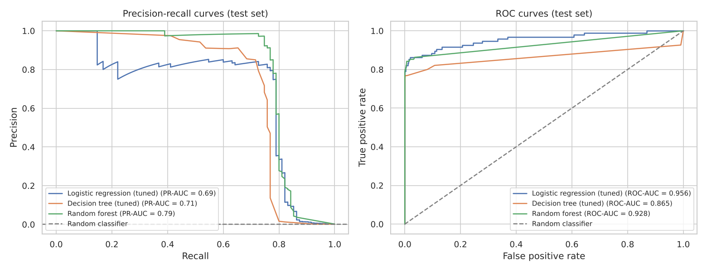
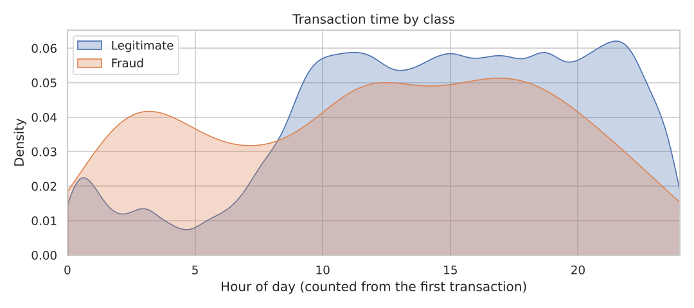

# Credit Card Fraud Detection

Detecting fraudulent credit card transactions in a highly imbalanced dataset (0.17 % fraud) with logistic regression, decision trees and a random forest. The notebook covers data cleaning, a hypothesis test on transaction timing, exploratory analysis, SMOTE oversampling, cross-validated hyperparameter tuning and an evaluation focused on the fraud class.

**Stack:** Python · pandas · scikit-learn · imbalanced-learn · SciPy · matplotlib · seaborn · Jupyter



---

## Results

Test set: 20 % of the data with the real class distribution (56,746 transactions, 95 frauds), never used for training, resampling or tuning.

| Model | Precision | Recall | F1 | ROC-AUC | PR-AUC | Frauds caught | False alarms |
|---|---|---|---|---|---|---|---|
| Logistic regression | 0.85 | 0.58 | 0.69 | 0.956 | 0.69 | 55 / 95 | 10 |
| Logistic regression + SMOTE | 0.05 | 0.87 | 0.10 | 0.960 | 0.68 | 83 / 95 | 1,493 |
| Decision tree | 0.71 | 0.68 | 0.70 | 0.842 | 0.49 | 65 / 95 | 26 |
| Decision tree + SMOTE | 0.32 | 0.72 | 0.44 | 0.857 | 0.23 | 68 / 95 | 146 |
| Decision tree (tuned) | 0.85 | 0.68 | 0.76 | 0.865 | 0.71 | 65 / 95 | 11 |
| **Random forest** | **0.97** | **0.74** | **0.84** | 0.928 | **0.79** | **70 / 95** | **2** |

Precision, recall and F1 are for the fraud class at a threshold of 0.5. Tuned logistic regression chose `C = 0.1` without SMOTE and scores the same as the untuned model.

**Findings**

- The **random forest** is the best model: it catches 70 of 95 frauds with 2 false alarms among 56,651 legitimate transactions.
- **SMOTE trades precision for recall** but does not improve PR-AUC; cross-validated tuning chose *not* to use it for either model.
- Limiting tree depth and leaf size fixes the overfitting of the decision tree (PR-AUC 0.49 → 0.71, false alarms 26 → 11).
- **ROC-AUC is misleading on imbalanced data:** logistic regression has the highest ROC-AUC but the lowest PR-AUC of the tuned models.
- About 20 % of frauds look legitimate to every model (all precision-recall curves collapse at a recall of about 0.8).
- Fraud is timed differently from legitimate activity (KS test, p < 10⁻¹⁴): it continues during the night, when legitimate transactions drop.



## Methodology

1. **Cleaning.** No missing values; 1,081 duplicate rows removed so that identical transactions cannot appear in both the training and the test set.
2. **Hypothesis test.** Kolmogorov–Smirnov and Welch's t-test on the hour of day of fraudulent vs. legitimate transactions.
3. **Split first.** Stratified 80/20 train/test split before any scaling or resampling. `Time` is not used as a model feature (it only counts seconds from the start of the two-day recording).
4. **Pipelines.** Scaling and SMOTE are pipeline steps (`imblearn.pipeline.Pipeline`), so they are fitted on training data only; during grid search they are refitted inside every cross-validation fold.
5. **Tuning.** `GridSearchCV` with stratified 5-fold CV, optimising average precision; whether to use SMOTE at all is part of the search.
6. **Evaluation.** Precision, recall and F1 for the fraud class, ROC-AUC and PR-AUC, confusion matrices and precision-recall curves. On data this imbalanced, accuracy and ROC-AUC look excellent even for weak models, so PR-AUC is the main metric.

## Getting started

```bash
git clone https://github.com/antonela-kovic/credit-card-fraud-detection.git
cd credit-card-fraud-detection
python -m venv .venv
source .venv/bin/activate        # Windows: .venv\Scripts\activate
pip install -r requirements.txt
```

Download `creditcard.csv` from [Kaggle](https://www.kaggle.com/datasets/mlg-ulb/creditcardfraud) into `data/`, then open `credit_card_fraud_detection.ipynb` with `jupyter notebook`. The whole notebook runs in a few minutes on a laptop.

**Google Colab:** upload the notebook, put `creditcard.csv` into Google Drive and set `DATA_PATH` in the first code cell.

## Project structure

```
├── credit_card_fraud_detection.ipynb   # analysis and models
├── data/                               # creditcard.csv (not included)
├── docs/                               # figures used in this README
└── requirements.txt
```

## Possible improvements

- Gradient boosting (XGBoost, LightGBM) and probability calibration
- Choosing the decision threshold from the cost of a missed fraud vs. a false alarm
- A time-based split (train on earlier, test on later transactions) to mimic deployment

## Data

Machine Learning Group, Université Libre de Bruxelles: *Credit Card Fraud Detection*, Kaggle (Database Contents License). A. Dal Pozzolo, O. Caelen, R. A. Johnson, G. Bontempi, *Calibrating Probability with Undersampling for Unbalanced Classification*, IEEE SSCI 2015.

## Author

Antonela Ković – [GitHub](https://github.com/antonela-kovic)
